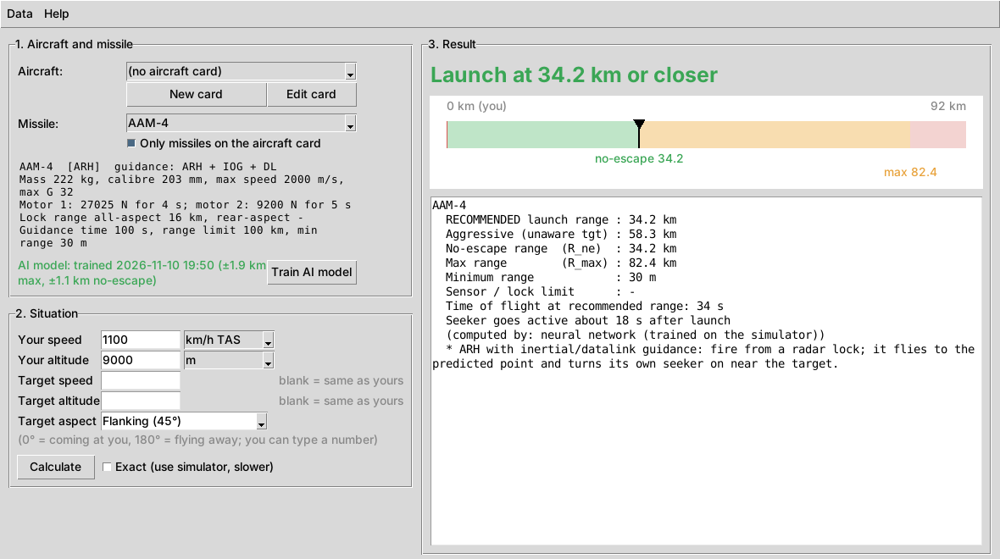

# War Thunder Missile Launch Assistant

A learning project: a small "AI" that estimates **the best distance to launch an
air-to-air missile in War Thunder**, given:

* the aircraft you fly (an *aircraft card*: its radar and the missiles it carries)
* the missile you picked (AIM-7P, AIM-9L, AAM-4 ...)
* your speed and altitude, and optionally the target's speed, altitude and aspect

It uses the in-game values from the community spreadsheet
**[Guided weaponry data (in-game values)](https://docs.google.com/spreadsheets/d/1mrVx7RlntCrA-NUDcJeeY7HDHhrwr0hQjIjf1y-6WUM/edit?gid=650249168#gid=650249168)**.

> For a video game only. All numbers are estimates from a simplified model of the
> game's missiles, not real-world data. This is a fan project, not affiliated with Gaijin.



---

## How it works

```
 spreadsheet (.xlsx/.csv)          aircraft card (.json)
          │                                 │
          ▼                                 │
  sheets.py  ──► data/missiles/*.json       │
          │                                 │
          ▼                                 ▼
  simulator.py  (physics: motor, drag, G-limit, guidance, fuze)
          │  thousands of simulated shots
          ▼
  envelope.py   ──► R_max and R_ne for each situation
          │
          ▼
  nn.py + train.py   neural network written from scratch (numpy only)
          │  learns  situation ──► (R_max, R_ne)
          ▼
  advisor.py   adds sensor limits (seeker lock range / your radar) ──► recommended range
          │
          ▼
  gui.py / cli.py
```

1. **Physics simulator** (`wtmla/simulator.py`): flies the missile with the sheet's
   values: one or two rocket motors (thrust, burn time, fuel mass, start delay),
   drag (sheet drag multiplier × a Mach-dependent curve, plus extra drag when pulling G),
   max G, the "pull limit" right after launch, proportional navigation with the sheet's
   PN multiplier and ETA schedule, loft, proximity fuze radius, guidance time and
   flight-range limit. Thousands of engagements are flown at once with numpy arrays.
2. **Envelope search** (`wtmla/envelope.py`): for a situation it finds
   * **R_max**: the longest launch range that hits a target that keeps flying straight
   * **R_ne** (no-escape): the longest range that still hits if the target turns away
     at 5 G the moment you fire and runs
3. **Neural network** (`wtmla/nn.py`): a multilayer perceptron with backpropagation and
   the Adam optimizer, written by hand in numpy (no ML libraries) so you can read every
   line. `train.py` simulates ~1500 random engagements per missile and trains the
   network to predict R_max and R_ne. A trained network answers instantly, which is what
   Part 2 (live in-game helper) needs. `gradient_check()` proves the backprop maths is right.
4. **Advisor** (`wtmla/advisor.py`): turns the ranges into advice and applies sensor
   limits. IR missiles must lock before launch (rear-aspect vs all-aspect lock range),
   SARH missiles need your radar to track the target, and ARH missiles with
   inertial/datalink guidance are limited by your radar.

### What the result means

| Value | Meaning |
|---|---|
| **Recommended** | Launch at this range or closer. Even if the enemy turns away when you fire, the missile should still reach it (R_ne), capped by your sensors. |
| **Aggressive** | Halfway between R_ne and R_max. OK against a target that doesn't notice the launch. |
| **Max (R_max)** | The missile only just reaches a target that keeps flying straight. |
| **Sensor limit** | Seeker lock range (IR / ARH without datalink) or your radar track range (SARH / ARH with datalink). |
| **Seeker goes active** | ARH only: seconds after launch until the missile's own radar is within its lock range. |

Aspect: `0°` = the target is flying straight at you, `90°` = crossing, `180°` = flying away.

---

## Setup (Windows)

1. Install **Python 3.10+** from python.org (tick *Add Python to PATH*; Tkinter is included).
2. Download this repo (green *Code* button → *Download ZIP*, or `git clone`).
3. In the folder, double-click **`run.bat`**. The first run installs `numpy` and `openpyxl`.

Linux/macOS: `pip install -r requirements.txt` then `python -m wtmla`.

## Get the missile data

The repo ships only **AAM-4** as a sample. Import the full sheet in one of two ways:

* **Automatic:** in the app, *Data → Download spreadsheet from Google Sheets*
  (or run `python -m wtmla download`). Every `AAM (...)` tab is imported.
* **Manual:** open the sheet, *File → Download → **Microsoft Excel (.xlsx)*** (this includes every tab;
  CSV/TSV only export the tab you are looking at), then
  *Data → Import spreadsheet file* (or `python -m wtmla import "Guided weaponry data.xlsx"`).
  One tab exported as `.csv` works too.

Missiles are saved as JSON in `data/missiles/`, one file per missile. You can read and edit them.
If the same name appears twice in the sheet, identical copies are skipped. A different
second version is kept with its tab name added, e.g. `AIM-9L [AAM (IR rear-aspect)]`.

## Aircraft cards

An aircraft card lists the plane's air-to-air missiles and its radar. The easiest way
to make one is from the **War Thunder wiki**:

1. Open the aircraft's wiki page, e.g. `https://wiki.warthunder.com/unit/su_30mkk`, and copy the link.
2. In the app click **From wiki...**, paste the link (or just `su_30mkk`) and press **Import**.
3. The app reads the page and saves the card with:
   * name, max speed and its altitude, max altitude, Mach and G limits
   * radar model (and whether it has search/track/TWS)
   * every **air-to-air missile** from *List of available weapons*, with each missile's wiki
     popup (guidance, lock ranges, launch range ...). Rockets, bombs and anti-radiation
     missiles are skipped.
4. A summary shows ✓ for each missile found in your imported spreadsheet and ✗ for ones that aren't.
5. The wiki doesn't list **radar ranges**, so the app offers to open the card so you can add
   the radar's lock/track range. Re-importing the same aircraft later keeps the ranges you typed.

Command line: `python -m wtmla add-aircraft https://wiki.warthunder.com/unit/su_30mkk`

If the download is blocked, open the page in your browser, press **Ctrl+S**, save as
*Webpage, HTML only*, then use **Open saved page (.html)...** in the same window.

**Missile list:** the Missile dropdown shows only the selected aircraft's missiles, in wiki order.
If a missile is missing (✗, or it has a different name in the spreadsheet), tick
**Show all missiles**: the aircraft's missiles stay at the top, followed by every imported missile.

You can also make or change cards by hand with **New card** / **Edit card**, or by copying
`data/aircraft/_template.json`:

* `weapons`: the air-to-air missiles it carries. Names are matched loosely, so `AIM-7F`
  matches `AIM-7F Sparrow` (but `R-27R` does not match `R-27R1`).
* `radar.track_range_km`: how far your radar can lock a fighter. This limits SARH/ARH advice.
* `radar.can_guide_sarh` / `radar.can_guide_arh`

## Use it

**GUI:** `python -m wtmla` (or `run.bat`). Pick aircraft and missile, type speed and
altitude (km/h TAS or IAS, Mach, knots; metres or feet), press **Calculate**. Press
**Train AI model** once per missile (~1 minute) for instant answers. Tick
**Exact** to always use the simulator instead.

**Command line:**

```bash
python -m wtmla list
python -m wtmla advise AAM-4 --speed 1100 --alt 9000
python -m wtmla advise AIM-7P --aircraft "F/A-18C Early" --speed 0.9 --speed-unit Mach \
                       --alt 20000 --alt-unit ft --target-speed 1.1 --aspect 45
python -m wtmla train AIM-7P            # or: train all
python -m pytest                        # run the tests
```

Example output:

```
AAM-4
  RECOMMENDED launch range : 32.9 km
  Aggressive (unaware tgt) : 62.5 km
  No-escape range  (R_ne)  : 32.9 km
  Max range        (R_max) : 92.0 km
  Minimum range            : 30 m
  Time of flight at recommended range: 31 s
  Seeker goes active about 16 s after launch
  (computed by: neural network (trained on the simulator))
```

## Accuracy and tuning

The spreadsheet has the missile values, but not the game's exact drag curves or
lift maths. Those are approximated by the constants in `PhysicsConfig`
(`wtmla/simulator.py`). To tune them to the game:

1. Test real shots in a custom battle or test flight, writing down speed, altitude,
   range and hit/miss.
2. Create `data/physics.json` with the values to change, for example
   `{"cl_max": 18, "induced_drag_k": 0.006, "escape_turn_g": 6}`.
3. Compare `python -m wtmla advise ... --sim` with your results and adjust.
4. Retrain the models. The app notices when a model is out of date.

**Not modelled:** flares/chaff, notching and radar Doppler gates, terrain, target
climbing/diving, seeker break-lock, multipath close to the ground.

## Project layout

```
wtmla/
  sheets.py      spreadsheet parser + downloader
  wiki.py        aircraft card from a War Thunder wiki page
  missile.py     MissileSpec data model
  aircraft.py    aircraft cards
  atmosphere.py  standard atmosphere, IAS/TAS/Mach
  simulator.py   batched 3D missile simulator
  envelope.py    R_max / R_ne search
  nn.py          neural network from scratch (MLP, backprop, Adam)
  train.py       dataset generation + training
  advisor.py     recommendation logic
  gui.py, cli.py
data/missiles/   imported missiles (JSON)
data/aircraft/   aircraft cards (JSON)
models/          trained networks (.npz)
docs/part2_plan.md   design for the live in-game helper
tests/
```

## Roadmap

* **Part 2: live helper** — see [docs/part2_plan.md](docs/part2_plan.md).
* Log your real in-game shots and fine-tune the network on them.
* Model target climbs/dives and notching.
